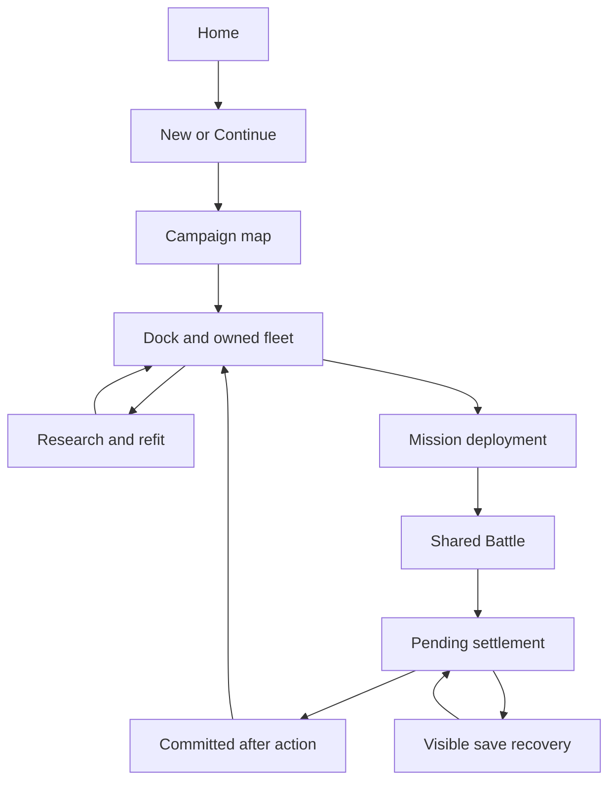

# Catastrophic Diplomacy — complete project audit

**Audit date:** 8 November 2026, Alaska time.  
**Audited production source:** [`0159042e47a9271e5e3b077756f5c4d57763a688`](https://github.com/mrcalzon02/Catastrophic-Diplomacy/commit/0159042e47a9271e5e3b077756f5c4d57763a688), `main`.  
**Matching published build:** [`cd-v0.1.5-dev.693`](https://github.com/mrcalzon02/Catastrophic-Diplomacy/releases/tag/cd-v0.1.5-dev.693).  
**Development order:** [Development repair plan](DEVELOPMENT_REPAIR_PLAN.md).  
**Durable work record:** [Checkpoints and evidence](audits/2026-11-08/CHECKPOINTS.md).

## 1. Assessment

The project has a substantial working simulation and a real cross-platform release. Fresh Java 17 compilation and the broad functional regression pass succeeded. Campaign ownership, atomic saves, paid research/refits, shared combat, nine technology tiers, physical ordnance, fighter recovery, the 48 survival variants, sensor networking, and authenticated server operation are implemented. Several older documents describe functionality that now exists as unfinished.

The principal repair need is the connection between these systems: the controller transitions around campaign results and saving; the mission context used by different screens; network state becoming a complete, usable battle view; and advanced sensor calculations receiving the right historical data. Passing individual subsystem tests currently leaves those integration failures exposed.

The audit reproduced **five campaign-controller defects, three combat defects, and a constrained-heap encyclopedia-search failure**. It also exercised network components that demonstrate session-reset, state-validation and presentation gaps. The report distinguishes those executions from source-only findings, incomplete features, design choices and device acceptance work. No production gameplay, workflow or release implementation was changed by this audit. The documentation and retained evidence are the deliverables.

The first repair should make a completed campaign engagement recoverable when its settlement cannot be saved. Next, unify the Results actions, mission context and research quote display. Narrow combat corrections can proceed independently. Multiplayer needs typed state and session boundaries before expanding its visible match lifecycle. [Campaign probe](audits/2026-11-08/CampaignFlowAuditProbe.java), [combat probe](audits/2026-11-08/CombatAuditProbe.java), [network probe](audits/2026-11-08/NetworkMirrorAuditProbe.java).

## 2. Scope, baseline and proof

The source inventory covered 215 production Java files, 179 Java test files and 115 pre-existing Markdown documents across core, shared client, server, desktop and Android. That is 46,129 production Java lines and 24,853 Java test lines at the baseline. Inventory coverage is not a claim that every line received the same review depth. Review concentrated on player entry/exit paths, state ownership, persistence, actual callers, resource authorization, failure handling and the existing development backlog.

### Evidence obtained

| Evidence | Result | What it establishes |
| --- | --- | --- |
| Normal Gradle 8.11.1 / Temurin 17.0.21+9 compile | PASS for core/game/server test compilation and desktop production compilation | Current source compiles through the project build; Android packaging was not rerun locally |
| Independent `javac --release 17` | PASS, 392 production/test source files outside Android | Independent source compilation; old project JARs were excluded from the compile classpath |
| Main functional invocation | PASS, **106 named Smoke tasks**; 118 actionable tasks, 108 executed and 10 up to date; 96 seconds | Campaign, research, resources, sensors, orders, shared-client routing/timing, update policy and real network fixtures within their individual test scope |
| Focused combined-arms/fighter/hardpoint/timeline follow-up | PASS | Real 200v200 mixed replay for 480 ticks; fighter and wing-codec checks; 506 baked hull maps / 9,515 anchors; 18 timeline environments and six variable-frame stall cases |
| Existing Python unit tests | PASS, **22 tests** | Publication retries, update-manifest handling, native-dialog helpers and tactical package checks |
| Android API compatibility scan | PASS | Checks the explicitly scanned incompatible Java APIs; does not replace Android compilation or device execution |
| Campaign atlas validator | PASS | 500 named missions, 50 fronts, 10 regions, 250 optional schematic lanes; 231 unique voice cues remain unrecorded |
| Focused campaign probe | Five defects reproduced through actual controller methods | Headless handler behavior with temporary storage and minimal Gdx interfaces; no rendered touch test claim |
| Focused combat probe | Three defects reproduced through normal battle execution | Causal navigation, withdrawal particle PD and live command-compute sharing failure |
| Focused network probe | Invalid state, session reuse and incomplete mirrors observed | Component and controlled framed-input behavior; not a multi-device GUI or unauthenticated attack demonstration |
| Wiki memory profiles | Broad index passes at 16 MiB; arbitrary search OOM at 16 MiB; succeeds at 32 MiB | A concrete constrained-HotSpot-heap defect and measured calling-thread work; not a physical S9 failure claim |
| Matching hosted release | All **16 jobs** successful: 15 build/runtime jobs plus publication | Exact-source Android/package/runtime, Linux and Windows release evidence |
| Downloaded public Linux ZIP | SHA-256 matches published checksum | Actual distributable bytes verified; a fresh local GUI session was not established |

Full logs, commands and observations are in the [evidence index](audits/2026-11-08/README.md), [functional result manifest](audits/2026-11-08/functional-result.json) and [functional log](audits/2026-11-08/functional-checks.log). The same-source hosted release is [run 42349197474](https://github.com/mrcalzon02/Catastrophic-Diplomacy/actions/runs/42349197474); its companion objective smoke is [run 42349197600](https://github.com/mrcalzon02/Catastrophic-Diplomacy/actions/runs/42349197600).

Initial local Gradle dependency resolution failed because the downloaded JDK was not using the environment's configured proxy and system truststore. Using those settings resolved it without changing project files. A local Xvfb launch failed because the environment refused its Unix display sockets. Therefore this audit does not claim fresh desktop pixels, Android touch interaction, physical Fire/S9 certification, or sustained GPU performance. Existing release artifacts and their dates must remain distinct from fresh audit executions.

### Classification and priority

**R** means a focused execution reproduced the behavior; **S** means a direct source trace establishes it; **I** means required integration is incomplete; **V** means a verification gap; **D** means an advisory diagnostic or decision. A source finding is not labelled reproduced simply because nearby tests passed.

**P0/P1/P2/P3 here describe repair order and impact, not a new release policy.** Build, launch/run and required multiplayer/updater failures retain the user's release-blocking rules. Visual style, numerical balance and performance measurements remain advisory. A measured 16 MiB profile failure must not be silently converted into a claim that every supported Android device fails.

## 3. Intended game flow and current breaks

The campaign authority is a combined generation of progress/wallet, owned fleet and researched technology. A blueprint is a design, not a purchased or repaired ship. Deployment binds permanent owned IDs to tactical slots. The terminal battle should generate one settlement and return to management only after that outcome is committed or explicitly retained as pending.

The pending-settlement recovery branch is the most consequential missing transition. The ordinary ledger's atomicity works; the frontend does not keep the player on a recoverable path when committing the outcome fails. See F01–F05 and the [detailed campaign review](audits/2026-11-08/CAMPAIGN_REVIEW.md).

| Path | Implemented authority and current evidence | Remaining repair or qualification |
| --- | --- | --- |
| Home → new campaign → faction → map | Single owned starter, initial technology and combined ledger committed before management | Corrupt authority blocks replacement; setup error channel is wrong, F02 |
| Launch → Continue | Valid primary/backup generation, legacy split-save migration only without existing authority | Both-invalid recovery needs an explicit visible action; active-sortie resume is a separate decision |
| Map → branching front → dock → deployment | `available()` defines branching access; deployment uses the actual mission | Dock/squadron activation incorrectly uses a linear frontier, F04 |
| Dock → blueprint → purchase/refit/service | Owned IDs, active/reserve, paid hull/crew/fuel/ammo/craft services and individual researched fittings | Keep these authorities; qualify depleted/refit/rejected-save controller paths |
| Research → quote → confirmation → victory work | Individual IDs, prerequisites, funded work, nine licenses and atomic purchase | Late-license selected budget card diverges from actual transaction, F05 |
| Mission → reinforcements → results → management | Same battle retains damage/ammunition across waves; real outcomes settle fleet/wallet/research | Failed settlement and Retry transition, F01/F03; report overlap, F20 |
| Skirmish → mixed fleet → deployment → battle → retry | Real individual designs, inclusive technology cap, validated codecs | Normal Android file exchange and setup-persistence clarity, F21 |
| Screensaver → shared battle → next round → Home | Uses `Battle`, with exhibition selection/camera and explicit wake handling | Device continuity, wake and visual acceptance remain open; no second engine is needed |
| Multiplayer → connection → fleet submit → battle → outcome | Pinned TLS/identity, authoritative orders, bounded submissions and snapshots | Readiness, session reset, semantic decode, full visible battle and input/result transitions, F06–F11 |
| Updates → discovery → download → verification → installer | Current prereleases included, drafts excluded, retained Android signer, status/progress | Real production-path tests and prior-save upgrade proof, F23–F26 |

## 4. Confirmed campaign repairs

### F01 — Completed battle settlement can be stranded after a save error

**P0 repair priority; R.** `finishEngagement()` computes returned vessels, reward, salvage and research, but opens ordinary RESULTS even when `commitCampaign()` fails. The error is placed in `dockNotice`, which Results does not draw. `leaveResults()` opens the dock with the previous state and does not retry settlement. The visible Retry button is a sortie action, not Retry Save.

The probe began from valid generation 1, injected a deterministic temporary-file write failure, and executed the actual finish handler on a winning fixture. Results showed victory with reward 0. After removing the fault and executing Return, the ledger remained generation 1. This does not mean the atomic ledger partially credited a victory: it correctly retained the prior whole state. The defect is loss of the recovery transition. Previous stores/losses may consequently remain authoritative as well as missing rewards.

Repair with an immutable pending settlement carrying source generation and proposed whole snapshot. Distinguish rejected-before-write from uncertain outcome; read back before retrying an uncertain write. Show an explicit pending-save state and retry action. Assert exact-once wallet, fleet IDs, stores and research on retry, duplicate input, draw, defeat and reopening. Preserve failure details on the visible screen. [Client 1807–1864, 2195–2212][client]; [ledger commit][ledger]; [reproduction](audits/2026-11-08/campaign-probe.log).

### F02 — Damaged primary and backup prevent both Continue and New Campaign

**P1; R.** The loader correctly refuses to invent replacement resources when authority files exist but neither validates. The new-campaign controller then uses ordinary commit, which rereads those same invalid files and fails. Actual restore followed by actual New Campaign stayed on setup with no campaign, preserving the corrupt bytes but offering no working recovery path. Its hidden message incorrectly suggests freeing space for a content-corruption error.

Provide explicit recovery choices: load a valid backup where available, preserve/export damaged files, or deliberately begin a new authority after a visible replacement decision. Ordinary loading must never silently mint a starter. Test primary/backup combinations, cancelled reset, unsupported atomic moves and inaccessible storage separately. [Client 1172–1187, 2130–2146][client]; [ledger 102–175][ledger].

### F03 — Tapping Campaign Results “Retry” has no effect

**P1; R.** The pointer handler calls `launchCampaignMission()` while on RESULTS; that method immediately returns unless the screen is DEPLOYMENT. The probe executed the real pointer dispatch and stayed on RESULTS. Keyboard R instead opens Dock, so input routes disagree.

Create one Results action shared by mouse, touch and keyboard. Prepare the next sortie from the committed surviving fleet, with services and deployment as appropriate. Keep the deployment guard; deleting it would bypass a useful state invariant. Resolve pending settlement first. [Client 564–570, 1780–1785, 2065–2074][client].

### F04 — Valid campaign branches receive an unrelated fleet cap

**P1; R for dock, S for matching squadron path.** After clearing mission 1, mission 31 is available and permits five ships. `unlocked()` is 2, a numeric frontier. Dock activation clamps the selected mission to that frontier and applies mission 2's one-ship cap. The actual dock handler refused a second owned vessel even though the same core roster operation accepted it with the selected mission's cap.

Resolve mission context once using `campaign.available(selectedMission)` and share it across map, dock, squadron activation, preview and deployment. Test available fronts 11/21/31, exact cap, locked inspection and early-mission replay after later progress. Preserve enemy force and reward rules. [Client 1455–1464, 1527–1536, 1619–1635][client]; [campaign access][progress].

### F05 — Tech VII–IX card conflicts with the correct pending quote

**P1 spending clarity; R.** Opening research uses the nine-tier range, but `requestResearch()` still clamps selection with `min(5, researchRank)`. The probe opened the next-license card for rank 6, then authorized Tech VII: selected card changed to already-owned Tech VI, showing **15,000,000 credits**, while the confirmation notice and core transaction correctly quoted **28,000,000**. These are conflicting card/confirmation displays; no incorrect debit was established.

Use one quote model for selected project, authorization text, balance preview and committed purchase. Test every license transition, especially VII–IX, insufficient funds, milestone rejection, cancellation and save failure. [Client 1249–1258, 1328–1349][client]; [menu budget cards][menu].

## 5. Multiplayer: working transport, incomplete player experience

Fresh `BattleServerTest` passed pinned-TLS loopback scenarios with 2, 32 and 400 ships, server-owned teams, accepted orders, authenticated reconnect and sequence retention. Terminal results and trusted-LAN mixed-tier/submitted fleets also passed. These are real networking tests. Old TLS failure receipts do not describe the current loopback result. They do not establish multi-device, long-soak or WAN acceptance. [Server test][server-test]; [functional log](audits/2026-11-08/functional-checks.log).

### F06 — Remote battle loses actual hull and ordnance/craft state

**P1; S plus component observations.** The host emits ship, missile, ballistic and craft rows. `drawRemoteBattle()` filters to ship rows. Ship rows do not preserve the full hull/fitting identity; `RemoteFleetMirrors` assigns every mirror `CORVETTE` and leaves missile/ballistic/craft collections empty. A mixed carrier/dreadnought battle can therefore be simulated correctly by the host while clients present corvettes without the emitted combat entities.

Version the presentation schema; carry stable entity IDs, hull/variant identity, lifecycles, visible resource state and required presentation events. Keep host damage authority. Validate two clients viewing mixed hulls, live missiles, kinetics, launch/recovery and removal. This is missing gameplay information, not an art-style complaint. [Client 3876–3908][client]; [mirrors][mirrors]; [server snapshot][server].

### F07 — Remote battle retains invisible controls and hides status transitions

**P1; S.** `MultiplayerPanel` installs its directory Stage as input processor. Battle view returns directly to remote drawing without detaching or disabling that Stage. Input can still reach invisible directory actors. That early return also bypasses the terminal/disconnected status text; the remote HUD only shows tick and a Tab hint. A frozen battlefield need not tell a touch-only player whether the battle ended or the connection failed.

Tie input ownership to explicit panel states, provide a visible battle HUD and return control, and show outcome/disconnect/reconnect status above the final accepted snapshot. Test that battlefield taps cannot activate hidden directory actions. Actual rendered desktop/Android interaction remains required; this audit establishes the source path, not an unseen click. [MultiplayerPanel 77, 142–160][multiplayer].

### F08 — New connection identity is not an interpolation boundary

**P1; S plus component reproduction.** WELCOME carries a server UUID, but the client discards it. Presentation resets only when tick regresses. A replacement session at the same tick retained old x=5/team=0 instead of fixture x=999/team=1; a later-tick session blended from the prior position. Tests covering only lower-tick restarts cannot establish correct session transitions.

Retain session identity and explicitly reset interpolation, mirrors and selection on a new session/connection. Preserve continuity only for a deliberately recognized same-session reconnect. Cover lower/equal/higher tick and reused host IDs. [Connection][connection]; [interpolation][interpolation]; [network observations](audits/2026-11-08/network-mirror-audit-probe.json).

### F09 — Semantically invalid snapshots reach the rendering parser

**P1; R at the controlled component boundary.** A correctly framed and checksummed invalid-faction row was accepted into `BattleConnection.snapshot()`, then threw in `RemoteShipInterpolation`. The parser also accepted team 9 and hull NaN. Position/facing checks alone do not validate a snapshot.

Decode to bounded typed entities on the reader side before publishing an immutable snapshot. Validate schema, enums, teams, IDs, counts, duplicates, finite values and sensible ranges. Reject incompatible state with a visible neutral reason and retain the last valid frame. This is trusted-host/protocol robustness; it does not prove an unauthenticated Internet client can inject through pinned TLS. [Connection][connection]; [interpolation][interpolation]; [probe](audits/2026-11-08/NetworkMirrorAuditProbe.java).

### F10 — Fleet submission immediately starts the match

**P1 feature completion; I/S.** The second accepted submission constructs the battle; there is no ready/unready/host-start lifecycle. The interface explicitly acknowledges the absence of ready-up. Separate accepted fleet, readiness and match start. Refit/resubmission/disconnect must invalidate readiness. The host should start only with both validated, ready seats, and no simulation ticks should occur before that transition. [Server receiveFleet][server]; [issue 25](https://github.com/mrcalzon02/Catastrophic-Diplomacy/issues/25).

### F11 — Secure custom-fleet lobby needs its supported entrypoint and test

**P2; I/V.** The TLS lobby factory already exists: `BattleServer.openLobby(..., Hbnet.Server)`. The supported secure `main` still starts the fixed-count starter battle, while the LAN CLI exposes the custom lobby; current submitted-fleet acceptance uses LAN. Expose the existing secure factory through supported configuration and exercise the full custom-fleet path over pinned TLS. Preserve the no-downgrade rule. Do not rewrite an allegedly missing factory. [Server][server]; [detailed review](audits/2026-11-08/NETWORK_RELEASE_REVIEW.md).

**Visibility decision:** current snapshots disclose exact positions/resources of both sides to every peer. If competitive PvP is intended to use the same sensor-limited information as solo play, introduce per-player projection before serialization; hiding pixels alone is insufficient. A separately omniscient spectator policy can remain. This protocol fact is confirmed; the intended competitive visibility contract should be recorded explicitly rather than inferred from incomplete UI. Broader invitation/presence/replay/WAN work follows the playable match lifecycle.

## 6. Combat and engineering correctness

### F12 — Navigation reacts to hidden present-time enemy position

**P1; R.** Target acquisition reads delayed observation history, then returns a mutable enemy Ship. Steering reads that ship's current x/y; some target ranking also reads current readiness/hull condition. The probe created two identical observation histories and changed only the enemy's present position in one world. At tick 13 both observers still saw `(600,100)` from tick 9, yet normal `Battle.step()` produced different headings and velocities before the new observation arrived.

Carry observed/estimated target state through ranking and steering. Preserve real geometry for collision and damage. Test that hidden-state changes cannot affect captain decisions until authorized evidence arrives, then do affect them after arrival. Keep deterministic replay and distinguish local, relayed and stale reports. [Battle chooseTarget/orderedSteer, 3177–3366][battle]; [combat evidence](audits/2026-11-08/combat-probe.log).

### F13 — Particle point defense is suppressed during withdrawal

**P1; R.** `fireParticlePointDefense()` skips withdrawing defenders outright. Other defensive families retain defense on retreat, matching the documented retreat contract. With the same seed, an actual fitted researched PPD and five actual incoming missile launches, the non-withdrawing control accumulated 70 paid beam ticks and the withdrawing case zero; both defenders remained alive and unescaped. The diagnostic stationary flag isolates eligibility, so full moving-retreat validation is still an acceptance step.

Apply defensive order, power, heat, mount and target rules consistently while the ship is physically withdrawing. Actual escape, HOLD_FIRE and unavailable hardware must still suppress fire. Preserve distinct PD behavior and balance. [Battle 6415][battle]; [orders contract](FLEET_ORDERS_SYSTEM.md); [probe](audits/2026-11-08/CombatAuditProbe.java).

### F14 — Command-compute donation cannot mature on the normal firing path

**P1; R plus source trace.** Shared compute requires sufficient time since report reception for a commander round trip. Normal firing obtains a report stamped with the current tick; relay delivery similarly reconstructs `receivedTick=now`. At nonzero ally separation, report age remains zero against a positive round trip. The core allocation test supplies an artificially older observation and misses that runtime interaction.

The probe ran 600 normal battle ticks with a physically fitted FCM donor, an assigned nearby ally and real firing. It observed positive donor capacity, 19 local allocations, all 19 exhausted, and **zero shared allocations**. Self-use at zero distance does not prove inter-ship sharing.

Preserve genuine reception history and model bounded command requests/returned solutions, or consume a causally mature stored report. Do not fix this by removing light-time checks. Assert no early sharing, later positive bounded donation, fair donor debit, power/damage rejection and replay parity. [Compute allocator][compute]; [relay delivery][relay]; [Battle receivedContact/fire][battle].

### F16 — Active scan doctrine exists in core but lacks normal selection/persistence

**P2; I/S.** Passive, standard, boosted, focused and X-ray scan modes have core behavior and tests, but normal player controls and saved doctrine do not apply a chosen scan mode. Integrate research/capability validation, visible selection/reasons, save/reopen and deployment/network application through the existing orders/technology authorities. Test from a real menu action to an observable runtime mode.

This finding does **not** include fighter optical/radar seekers. Those are already selected in the shipyard, persisted in `design.fighterSeeker`, checked against FTR research and applied on spawn; both UI and runtime blueprint tests passed. An early inference based only on unused convenience setters was rejected during the audit. [Target-seeking plan](TARGET_SEEKING_LIGHT_MINUTE_AND_UNCERTAINTY_PLAN.md); [shipyard](../game/src/main/java/diplomacy/client/ShipyardPanel.java).

### F17 — Full per-bay mixed-wing persistence remains incomplete

**P2; I.** Launch, physical recovery, paid rearm, pilot survival and ordinary fighter persistence exist. The phase-two contract is larger: stable physical bays, mixed independent wing complements, per-bay damage/throughput and a live shipyard-to-campaign-to-battle settlement bridge. Helper codecs and isolated model tests are not evidence that the entire player path uses them. Finish the remaining bridge against [issue 28](https://github.com/mrcalzon02/Catastrophic-Diplomacy/issues/28); preserve working recovery and native carrier capacity.

**FCM feature scope:** F14 repairs existing donation. It does not finish the separate multi-source measured-track fusion, covariance/hypothesis reconciliation and shared scheduling requested in [issue 30](https://github.com/mrcalzon02/Catastrophic-Diplomacy/issues/30). Extend these after causal input and donation work correctly; do not describe a classification bonus or single-source selection as full fusion.

### Working combat systems to retain

| System | Current evidence | Remaining boundary |
| --- | --- | --- |
| Shared combat | Campaign, skirmish and screensaver use `Battle` | Exhibition lifecycle/camera policies differ legitimately; no separate engine rewrite |
| Maneuver doctrine | FREE blends radial/tangential movement; HOLD_RANGE is an explicit order | F12 corrects information use, not removal of continuous maneuver |
| Timing | 30 Hz per simulated second, interpolation/birth poses, remote tweening, camera easing, diagnostics and export | Device smoothness remains unproven; deliberate label mapping described below |
| Weapons/ammunition | Physical projectiles, finite resources, per-rack configuration, staged guidance, cold coasting and pending salvos | Additional seeker uncertainty/hypothesis work is staged; no blanket claim all future designs complete |
| PD | Distinct flak/rotary/rail/particle/laser/interceptor mechanisms and targeting/resource rules | F13; measure largest-volley leakage as a balance diagnostic, not a universal counter promise |
| Survival | Twelve roots plus all 48 variant lineages, unsafe-only seeded faults, researched fitting | Keep the variants active; numerical balance/target-device qualification remains |
| Sensors | Six differentiated network families, delayed records, live/stale distinction, bounded compute and relay | F12/F14/F16 and multi-source integration |
| Technology/hulls | Nine ranks; base hull sizes by Tech III; later variants/modules; current 2,035 components and 73,260 upgrades | Do not reuse older catalog counts or reinstate six-tier assumptions |

`CombatPace` intentionally maps displayed 0.5–3.0 settings to 0.05–0.30 physical simulation multiplier. Thus displayed 0.5x schedules approximately 1.5 authoritative steps per wall second before interpolation. That is a legacy perceived-pace mapping, not proof the simulation uses 1.5 Hz per simulated second. Document the distinction and measure displayed continuity; changing it to literal physical 1x would be a gameplay-speed decision. [CombatPace][pace]; [timing implementation ledger](performance/battlespace-timing-test-environments.md).

**Resource-order reconciliation:** current code has 32 standing-order settings on four pages and `CD-STANDING-4` with V1–V3 migration. Fuel economy, protected reserve, automatic withdrawal at reserve, reserve spending during withdrawal/LAST_STAND, immediate/hold offense, rationing, reserves, spaced volleys and energy-only policies are implemented. Pending missile/torpedo/rocket commitments enter authorization. Older text calling fuel autonomy wholly unimplemented is stale. Remaining extensions include per-family overrides, richer precision/wait fire decisions, coordinated reactor/shield/PD/repair reserves, energy-first scheduling, resupply priorities and visible hold reasons. [Detailed combat review](audits/2026-11-08/COMBAT_REVIEW.md).

## 7. Memory, readability and operation

### F15 — Arbitrary encyclopedia search can exhaust a constrained heap and block input

**P1/P2 by target impact; R.** The 16 MiB broad-index profile succeeded with 75,476 articles and 73,260 upgrades. Arbitrary search then failed with `OutOfMemoryError` in `TechnologyCatalog.get()` from `GameWikiCatalog.search()`. At 32 MiB, `plasma` took approximately 667 ms and `power x1.00` approximately 1,360 ms in this run; broad `tech` reused the fast index. These are host observations with concurrent audit work, not device benchmarks.

`GameWikiPanel.setQuery()` synchronously calls refresh/search, including per-character typing. Preserve complete result sets, ordering, exact numeric/full-text semantics and selection while reducing temporary upgrade/ancestor construction. Use bounded incremental/cancellable query work or an allocation-light index; keep presentation responsive and never trim real technology to meet a memory number. Verify full-text oracle parity and low-heap behavior, then actual Android typing. [Search 599–642][wiki]; [panel 36–72][wiki-panel]; [profile results](audits/2026-11-08/wiki-results.json).

### F20 — After-action text rows overlap

**P3 presentation diagnostic; S.** Vessel identity text is drawn at `y-17` and expenditure detail at `y-20`, only three pixels apart at normal font height. Allocate measured separate lines and paginate long reports. Confirm with actual desktop/mobile renders; no screenshot was manufactured for this audit. [Menu 1275–1279][menu].

### F21 — Fleet exchange is encoded but awkward to use on Android

**P2 usability/integration; I/S.** Validated fleet/challenge imports and exports exist, but the examined frontend uses fixed app-private paths rather than a normal Android picker/share workflow. Provide a platform adapter around the existing codecs, with visible filename/operation results, cancellation and rejected-import preservation. Do not redesign the universal catalog or accept an invalid fleet simply to improve exchange. [Campaign/skirmish review](audits/2026-11-08/CAMPAIGN_REVIEW.md).

The prior UI pass is present: Atkinson Hyperlegible, centered bounded labels, step voice controls, persistent update status and Dev options. These should remain the common visual/control baseline. Dense specialized shipyard/research layouts still need actual touch/readability acceptance, but old generic complaints must not automatically be logged as missing implementation. [Prior implemented audit](UI_OPERATIONAL_AUDIT.md).

## 8. Updaters and release operation

Source and existing policy tests support including published prereleases and excluding drafts. Android checks downloaded package identity, newer version, expected version and retained signer before installer handoff. Manual checks provide progress and actual downloads. Desktop selects platform packages, checks size/optional digest and gives installer/folder handoff. No current reproduced discovery/signing blocker was found. The stale draft 692 appearing early in creation-ordered API output is not the latest published release. [Android updater][android-update]; [desktop updater][desktop-update]; [update policy][update-policy].

### F23 — Updater acceptance does not exercise the complete current user path

**P1 verification priority; V/S.** The Android debug-intent dialog test still opens `showAvailableUpdate`, checks Update/Later/View release and presses Later. The production manual check now directly checks/downloads, so this does not validate the whole current manual path. The API29 upgrade fixture installs an older APK and immediately upgrades without first creating an old-version campaign/profile sentinel. Later save/resume tests establish the new version's persistence, not preservation of pre-upgrade user data.

Exercise the actual Home update action through no-update status, newer download, progress, size/digest/package/signer rejection, permission return and installer handoff. Before an in-place upgrade, create identifiable campaign/technology/fleet/orders/settings data with the old app, verify it, upgrade and reopen unchanged. Apply equivalent saved-state checks to Windows upgrade. This is missing proof, not an asserted current save-migration defect. [Android dialog script][update-dialog]; [release workflow][release-workflow].

### F24 — Publication recovery rejects a supported release entrypoint

**P2; S.** Normal release supports manual dispatch and a deliberate request-file push. The recovery workflow requires the source run event to be `push`. An otherwise eligible manually dispatched run whose only failure is publication is rejected. Accept the authorized supported entrypoints while retaining source ancestry, exact artifacts, successful required jobs and public readback. Never retag or silently overwrite artifacts. [Recovery workflow][recovery].

### F25 — Desktop discovery depends on old-tag metadata remaining available

**P2 conditional defect; S.** Discovery first reads the installed release tag's live metadata. If that tag is removed or unpublished, the request aborts before considering newer published releases. No current missing-tag failure was observed. Add a tested fallback based on packaged identity and safe release ordering; do not assume a disappearing tag means already current. [Desktop updater][desktop-update].

### F26 — Android update discovery scales with the full release history

**P2 efficiency/rate-exposure risk; S plus inventory.** The inspected inventory contained 151 published releases and two drafts. Android requests ten entries per page and traverses the feed, requiring 16 requests before manifest/download work for a full check. No cache/ETag/backoff path was found. This is not a recorded outage. Introduce bounded conditional caching and retry behavior while preserving correct newest-published selection, draft exclusion and manual feedback. [Android updater][android-update]; [detailed release review](audits/2026-11-08/NETWORK_RELEASE_REVIEW.md).

### F18 — The single automatic job misses important source changes

**P1 verification coverage; S.** Current main-push smoke paths omit `server/**`, `hbnet/**`, `diplomacy/net/**`, Android/desktop updater code and much campaign/persistence source. A change only to those paths can receive no automatic functional smoke before a deliberate release. Broaden the existing single job's relevant triggers and select meaningful checks; do not add unrelated workflows or reintroduce automatic package fan-out. [Smoke workflow][smoke-workflow].

### F19 — Some visual/source conventions still enter mandatory checks transitively

**P2 release-policy consistency; S.** The mandatory menu flow task depends on shader tests that assert exact source substrings/visual conventions and on fixed voice-inventory assumptions. A valid refactor or authorized content expansion can therefore become a blocking failure without an observed build/run problem. Classify individual assertions: retain required resource validity, shader compilation, finite calculations and runtime behavior; keep implementation spelling, artistic style and balance advisory. Do not remove all renderer/audio tests. [Game tasks][game-build]; [shader test][shader-test].

### Actual workflow inventory

| Category | Count | Trigger/purpose |
| --- | ---: | --- |
| Routine objective smoke | 1 workflow / 1 job | Selected main source paths or manual dispatch |
| Verified release | 1 workflow | Deliberate `.github/release-request.json` change or manual dispatch; platform/runtime jobs and publication |
| PR verification | 1 workflow / 3 jobs | Relevant PR paths; no signed publication |
| Specialist diagnostics | 18 workflows | Manual only |
| Publication recovery | 1 workflow / 1 job | Manual only |
| Scheduled workflows | 0 | No repository workflow schedule found |

There are **22 workflow files**, not 22 automatic main-push runs. The explicit cross-platform release expands to 16 jobs including its 11 faction shards and publisher. Consolidating routine checks to one job and retaining necessary platform release jobs are different concerns. No workflow was dispatched by this audit. [Current workflow guide](CI_WORKFLOWS.md).

## 9. Existing issue and document reconciliation

### F22 — Historical documents are being mistaken for current implementation state

**P2 maintenance/rework prevention; S.** README/acceptance/CI/campaign/fighter documents contain older missing-feature statements or counts. The new audit and repair plan provide the current dated baseline; the CI guide is reconciled to live YAML. Preserve old receipts with dates instead of rewriting history into a false pass. Treat a new implementation, its objective test and physical-device acceptance as three separate statuses.

| Open issue | Current reconciliation | Remaining work |
| --- | --- | --- |
| [#3 UI artwork](https://github.com/mrcalzon02/Catastrophic-Diplomacy/issues/3) | Source-backed runtime selection and common UI updates exist | Actual visual/touch acceptance and provisional-art cleanup; advisory unless required resources break runtime |
| [#24 campaign technology](https://github.com/mrcalzon02/Catastrophic-Diplomacy/issues/24) | Individual per-faction IDs, prerequisites, paid work, authorization and combined persistence are implemented and tested | F05; full frontend/legacy path coverage, tree usability and intended NPC economic progression |
| [#25 PvP lobby](https://github.com/mrcalzon02/Catastrophic-Diplomacy/issues/25) | Custom fleet submission/validation and server snapshots work | F06–F11; do not close for CLI submission alone; use current nine-tier catalog, not old six-tier wording |
| [#26 ordnance](https://github.com/mrcalzon02/Catastrophic-Diplomacy/issues/26) | Inertia, cold coast, phases, physical seekers and per-rack configuration have passing tests | Later behavioral/hypothesis refinements and measured large-fleet behavior |
| [#28 flight decks](https://github.com/mrcalzon02/Catastrophic-Diplomacy/issues/28) | Native carrier capacity, real launch/recovery/rearm and pilot accounting exist | F17 full bay/wing configuration and persistence bridge |
| [#29 hardpoints](https://github.com/mrcalzon02/Catastrophic-Diplomacy/issues/29) | Build-baked checksum-validated resource is used by core and client | Source-matched graphical origin/coverage acceptance; do not reimplement the baked map |
| [#30 fusion](https://github.com/mrcalzon02/Catastrophic-Diplomacy/issues/30) | Six distinct network families, attributed contacts and compute plumbing exist | F14 and full measured multi-source fusion/shared arbitration |
| [#31 light-minute targeting](https://github.com/mrcalzon02/Catastrophic-Diplomacy/issues/31) | Fixed arena, scale, historical observations, delayed projectiles/seekers and many causal tests exist | F12/F16 and remaining higher-fidelity hypotheses/trajectories; read latest implementation sections before older plan paragraphs |
| [#32 speed/diagnostics](https://github.com/mrcalzon02/Catastrophic-Diplomacy/issues/32) | Six settings, governor, HUD/Dev toggles, recorder/export and smoothing tests exist | Actual target-device continuity, comparable frame-tail/texture traces and documented pace semantics |

Open PR #23 concerns a separate older Play branch. Its historical timeout is not evidence that current main or release 693 fails. None of these issues was closed or messaged by this audit.

## 10. Decisions and acceptance still needed

These are explicit boundaries, not excuses to postpone the obvious repairs above.

- **Interrupted or abandoned sorties:** management saves persist; active-battle resume and the cost of tactical Restart/Home are not a fully specified durable sortie contract. Decide whether leaving means abandon, replay from departure state, or resume. Do not invent losses, bankruptcy bailouts or ironman penalties while fixing settlement.
- **PvP player versus spectator knowledge:** specify sensor-limited competitive payloads and reconnect/seat-release policy before declaring parity with solo fog/targeting.
- **Campaign economy and NPC research progression:** existing catalog and tier legality are real. The exact intended AI funding/unlock-history model and long-campaign affordability need a deliberate progression playthrough, not an invented arbitrary rebalance.
- **Physical performance:** run the same seeded 1v1, medium and 200v200 scenes on S9/Android 10 and the intended later Android/Fire targets, plus desktop. Compare 0.5/1/1.5/2/2.5/3 settings, pause/resume, camera sweeps, thermal/load behavior, dropped wall time and displayed projectile continuity. Record p50/p95/p99 and texture upload/eviction; numerical targets remain diagnostics under the established policy.
- **Lifecycle:** test real Android background/process kill, orientation/viewport, installer return and save upgrade; Windows upgrade, Linux launcher from a clean working directory, and graphics-context recreation.
- **Readability and content:** inspect dense shipyard/research/after-action screens on actual mobile, long names and large fleets; finish the unrecorded campaign voice queue and provisional visuals after the functional path is reliable. No content completion percentage is inferred from named mission count.

## 11. Completion criteria for the next development phase

An item is complete only when its previously demonstrated wrong behavior changes, the relevant core and actual controller/network paths pass, source and tests are committed on `main`, the remote commit/content is read back, and applicable real artifacts are verified. A proposed fix, a passing unrelated test or a report is not implementation progress.

The repair plan separates bounded changes, dependencies, decisive tests and rollback boundaries. It preserves the user's fixed policies: single main, no force push, no retagging, published prereleases count as latest, no extra unrelated CI, shared combat, nine tiers/Tech III base hulls, continued survival variants, and functional rather than aesthetic release gates. [Development repair plan](DEVELOPMENT_REPAIR_PLAN.md).

[client]: https://github.com/mrcalzon02/Catastrophic-Diplomacy/blob/0159042e47a9271e5e3b077756f5c4d57763a688/game/src/main/java/diplomacy/client/CatastrophicGame.java
[menu]: https://github.com/mrcalzon02/Catastrophic-Diplomacy/blob/0159042e47a9271e5e3b077756f5c4d57763a688/game/src/main/java/diplomacy/client/GameMenuPanel.java
[ledger]: https://github.com/mrcalzon02/Catastrophic-Diplomacy/blob/0159042e47a9271e5e3b077756f5c4d57763a688/core/src/main/java/diplomacy/sim/CampaignLedger.java
[progress]: https://github.com/mrcalzon02/Catastrophic-Diplomacy/blob/0159042e47a9271e5e3b077756f5c4d57763a688/core/src/main/java/diplomacy/sim/CampaignProgress.java
[battle]: https://github.com/mrcalzon02/Catastrophic-Diplomacy/blob/0159042e47a9271e5e3b077756f5c4d57763a688/core/src/main/java/diplomacy/sim/Battle.java
[compute]: https://github.com/mrcalzon02/Catastrophic-Diplomacy/blob/0159042e47a9271e5e3b077756f5c4d57763a688/core/src/main/java/diplomacy/sim/SensorComputeBudget.java
[relay]: https://github.com/mrcalzon02/Catastrophic-Diplomacy/blob/0159042e47a9271e5e3b077756f5c4d57763a688/core/src/main/java/diplomacy/sim/SensorRelayBuffer.java
[pace]: https://github.com/mrcalzon02/Catastrophic-Diplomacy/blob/0159042e47a9271e5e3b077756f5c4d57763a688/game/src/main/java/diplomacy/client/CombatPace.java
[server]: https://github.com/mrcalzon02/Catastrophic-Diplomacy/blob/0159042e47a9271e5e3b077756f5c4d57763a688/server/src/main/java/diplomacy/server/BattleServer.java
[server-test]: https://github.com/mrcalzon02/Catastrophic-Diplomacy/blob/0159042e47a9271e5e3b077756f5c4d57763a688/server/src/test/java/diplomacy/server/BattleServerTest.java
[connection]: https://github.com/mrcalzon02/Catastrophic-Diplomacy/blob/0159042e47a9271e5e3b077756f5c4d57763a688/core/src/main/java/diplomacy/net/BattleConnection.java
[multiplayer]: https://github.com/mrcalzon02/Catastrophic-Diplomacy/blob/0159042e47a9271e5e3b077756f5c4d57763a688/game/src/main/java/diplomacy/client/MultiplayerPanel.java
[mirrors]: https://github.com/mrcalzon02/Catastrophic-Diplomacy/blob/0159042e47a9271e5e3b077756f5c4d57763a688/game/src/main/java/diplomacy/client/RemoteFleetMirrors.java
[interpolation]: https://github.com/mrcalzon02/Catastrophic-Diplomacy/blob/0159042e47a9271e5e3b077756f5c4d57763a688/game/src/main/java/diplomacy/client/RemoteShipInterpolation.java
[wiki]: https://github.com/mrcalzon02/Catastrophic-Diplomacy/blob/0159042e47a9271e5e3b077756f5c4d57763a688/game/src/main/java/diplomacy/client/GameWikiCatalog.java
[wiki-panel]: https://github.com/mrcalzon02/Catastrophic-Diplomacy/blob/0159042e47a9271e5e3b077756f5c4d57763a688/game/src/main/java/diplomacy/client/GameWikiPanel.java
[android-update]: https://github.com/mrcalzon02/Catastrophic-Diplomacy/blob/0159042e47a9271e5e3b077756f5c4d57763a688/android/src/main/java/diplomacy/android/SideloadUpdater.java
[desktop-update]: https://github.com/mrcalzon02/Catastrophic-Diplomacy/blob/0159042e47a9271e5e3b077756f5c4d57763a688/desktop/src/main/java/diplomacy/desktop/DesktopReleaseUpdater.java
[update-policy]: https://github.com/mrcalzon02/Catastrophic-Diplomacy/blob/0159042e47a9271e5e3b077756f5c4d57763a688/core/src/main/java/diplomacy/update/UpdatePolicy.java
[update-dialog]: https://github.com/mrcalzon02/Catastrophic-Diplomacy/blob/0159042e47a9271e5e3b077756f5c4d57763a688/tools/android_verify_update_dialog.sh
[release-workflow]: https://github.com/mrcalzon02/Catastrophic-Diplomacy/blob/0159042e47a9271e5e3b077756f5c4d57763a688/.github/workflows/continuous-functional-release.yml
[smoke-workflow]: https://github.com/mrcalzon02/Catastrophic-Diplomacy/blob/0159042e47a9271e5e3b077756f5c4d57763a688/.github/workflows/release-blocker-smoke.yml
[recovery]: https://github.com/mrcalzon02/Catastrophic-Diplomacy/blob/0159042e47a9271e5e3b077756f5c4d57763a688/.github/workflows/publish-verified-artifacts.yml
[game-build]: https://github.com/mrcalzon02/Catastrophic-Diplomacy/blob/0159042e47a9271e5e3b077756f5c4d57763a688/game/build.gradle
[shader-test]: https://github.com/mrcalzon02/Catastrophic-Diplomacy/blob/0159042e47a9271e5e3b077756f5c4d57763a688/game/src/test/java/diplomacy/client/ShipSurfaceShaderTest.java
