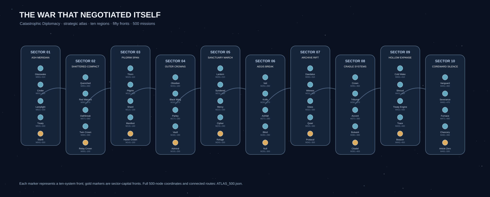

# The War That Negotiated Itself — campaign production desk

The canonical narrative package for **Catastrophic Diplomacy** is organized here. The underlying battle simulator still operates on 500 sequential missions, fifty ten-system fronts, ten fifty-mission sectors, an eleven-faction opposition roster and Tech 0–IX. New story geography has been surfaced in the real in-game campaign map; voice scripts are **written but unrecorded and not yet wired into playback**.



## Read in this order

1. [STORY_BIBLE.md](STORY_BIBLE.md) — rules of the fictional universe, characters, diplomacy, stakes, 10 arcs, hidden reveal timeline, finale
2. [GALACTIC_ROUTE.svg](GALACTIC_ROUTE.svg) — large editable strategic schematic of 10 regions and 50 fronts (gold nodes = capital fronts)
3. [ATLAS_500.json](ATLAS_500.json) — **500 unique named mission sites**, exact sequential links, proposed 250 reversible schematic side-lane connections, strategic coordinates, faction opposition, enemy ceiling, ship cap, waves, proposed fiction objective and chapter clear discovery
4. [scripts/VOLUME_01_BORDER_SIGNALS.md](scripts/VOLUME_01_BORDER_SIGNALS.md) — recording-ready opening and missions 001–010
5. [scripts/CHAPTERS_AND_FRONTS.md](scripts/CHAPTERS_AND_FRONTS.md) — recording-ready openings/transitions/conclusions for all 50 fronts
6. [scripts/VOLUME_10_FINAL_OFFENSIVE.md](scripts/VOLUME_10_FINAL_OFFENSIVE.md) — recording-ready final seven mass battles, epilogue and optional endings
7. [scripts/VOICE_CUE_MANIFEST.csv](scripts/VOICE_CUE_MANIFEST.csv) — exact unique speaker IDs, lines and recording status
8. [scripts/RECORDING_GUIDE.md](scripts/RECORDING_GUIDE.md) — solo voice session order, filter suggestions, cue slicing and sound-mix policies

## Domain-map design contracts

The main story route must always proceed **001 → 002 → … → 500** until actual alternate-path unlocking is engineered. Every ten missions form a front; every fifth front culminates in a sector capital. The 250 side-lane segments in the data illustrate plausible local routes but **are not implemented alternate mission unlocks**. Keep the global strategic coordinates separate from the live battlefield's renderer coordinates, and do not assume that listed weather, traffic, sanctuaries or archived evidence are physically instantiated objects.

The `opponent`, `operation`, `enemy_tier`, `fleet_cap` and `waves` in the JSON are snapshot annotations calculated from the existing campaign rules, not a second runtime authority. Java is the executable authority. Changing the Java campaign formulas without regenerating/reviewing the annotations makes them stale. All proposed fiction objectives must remain visually distinguished from the current **destroy every mandatory hostile wave** victory condition.

`CampaignStoryAtlas.java` is the small native Java lookup used for names, regions and front mandates. `CampaignMap.page` still supplies the familiar ten connected system nodes and faction-dependent enemy fittings. `GameMenuPanel` displays concise region, location and front purpose without changing touch target geometry or campaign unlock behavior.

## Narrative release and voice policy

Campaign acting is designed for the owner's recognizable natural narrator plus selective **tested Voicemod PRO alien voices**. The owner previously used particular Voicemod presets to perform the **260 already recorded hull radio cues**; those ten established hull voice roles must be preserved rather than replaced or confused with the new campaign cast. The existing 30-cue announcer audio is still the *game announcer*, independent of story characters. The exact ten hull banks' prerecorded combat lines remain voiced; unrecorded messages use text and calm bleeps. All 231 story cues are **not recorded** in this package; a cue manifest is not sound.

A scripted mission opening is skippable; completing a mission is what authorizes its conclusion. Never play a success discovery after defeat or retreat. A future mid-battle line must have a genuine event trigger and must never be faked by a random timer. Ending-choice lines remain optional prose until an actual saved ending choice exists.

## Validation

Run the optional narrative diagnostic:

```sh
python tools/validate_campaign_story_atlas.py
```

Compile and test executable changes through the project's existing Gradle and Actions tests (`:core:campaignOppositionSmoke`, `:core:gameFlowSmoke`, `:game:gameMenuSmoke`, and desktop/Android acceptance as applicable). Story prose, map polish and acting quality are **diagnostics only**, not release-blocking tests. A source push is not a signed APK or a passed device run.

**Writing roadmap:** expand fully acted mission scenes from 011–493 as needed, prioritizing each sector capital, politically significant turning points, and the 50 front transitions. Do not attempt to record 500 identical mission briefings or a single voice pretending to be every fighter pilot.
