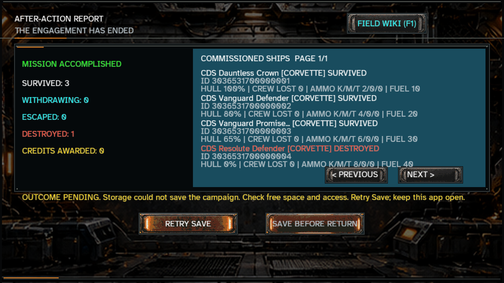
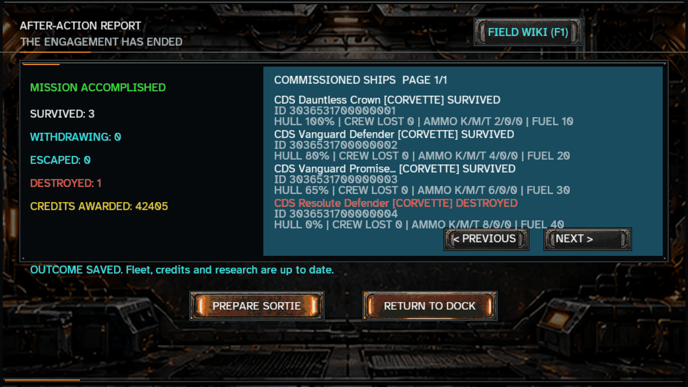
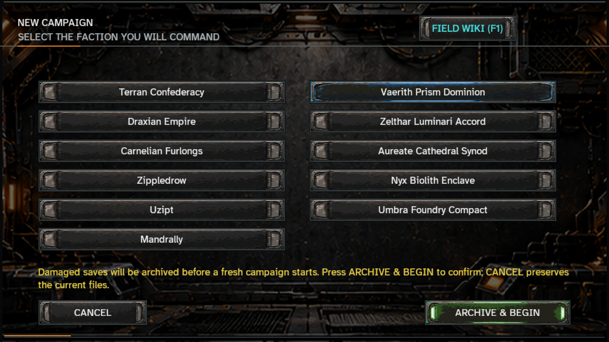

# Campaign recovery and controller repairs — 8 November 2026

**Implementation:** [`4d5ed0028ae2d8b34dcff315924b597cc6708cd5`](https://github.com/mrcalzon02/Catastrophic-Diplomacy/commit/4d5ed0028ae2d8b34dcff315924b597cc6708cd5). **Hosted verification:** [run 42509215714](https://github.com/mrcalzon02/Catastrophic-Diplomacy/actions/runs/42509215714), one successful job at that exact source. All eleven implementation-checkpoint files were read back and compared byte for byte before claiming delivery.

This is the first implementation batch from the [development repair plan](../../DEVELOPMENT_REPAIR_PLAN.md). It addresses campaign findings F01–F05, the Results layout in F20, runtime coverage in F18, and the shader-source portion of F19. The original audit remains a historical description of production source `0159042`.

## Resulting player behavior

| Path | Repaired behavior |
|---|---|
| Battle ends and storage write fails | Results retains a frozen outcome and displays **Retry Save** plus a visible pending message. Wallet/fleet/research authority is not partially adopted. |
| Return, Escape or Back while settlement is pending | The report remains open. No earned outcome is silently discarded and no second sortie spends the old stores. |
| Storage recovers and Retry Save is selected | The same proposed generation is written once, or recognized as already saved after a lost acknowledgement. Credits, losses, returned stores and research update together. |
| Repeated finish/retry input | The computed outcome is not regenerated; acknowledged settlement does not create another reward or generation. |
| Saved campaign Results → next sortie | Pointer and keyboard use **Prepare Sortie**, entering deployment with the committed surviving roster. An empty active roster returns to fleet management. |
| Campaign map → Enter | Opens the same valid deployment path as pointer controls. Locked missions stay locked. |
| Both authority copies are damaged | First Begin explains recovery and arms **Archive & Begin**. Explicit confirmation preserves verified original bytes before writing the single-starter, zero-credit campaign. |
| Cancel or change faction during a creation whose acknowledgement was lost | Readable authority is reconciled before abandoning the pending intent. Unavailable storage retains the intent and visible explanation. |
| Branching mission → dock/squadron activation | The playable selected mission supplies its cap. Mission 31 permits five owned active vessels after mission 1 instead of inheriting mission 2's one-ship cap. |
| Tech VII–IX authorization | The selected card matches the actual pending license and quote. The core debit rules remain intact. |
| After-action report | Four rows separate name, ID and expenditure baselines; save status and action buttons remain clear. |

## Persistence contract

The existing ledger encoding is unchanged. `CampaignLedger.inspect` distinguishes missing, valid, damaged and inaccessible authority. A readable valid backup still recovers a missing/corrupt primary; an inaccessible copy is not presumed corrupt or silently replaced.

`commitRecoverably` receives the exact before/proposed snapshots. It acknowledges an already-stored proposal without another write, otherwise checks complete canonical authority before applying the next generation. It reconciles failures after writing and returns an explicit unknown-outcome status when storage cannot be read. The strict existing `commit` entrypoint continues to reject stale/duplicate generations.

Explicit corrupt reset streams and fsyncs original primary/backup contents into a unique sibling recovery directory, checks sizes and SHA-256 digests, rechecks the originals, and only then replaces primary atomically. A valid backup prevents this reset path. A returned archive path means all copies passed final verification. Archives remain in application storage; ordinary Android archive export is still part of the later file-provider work.

Pending battle state is frozen as canonical encoded snapshots so later mutation of an in-memory fitting or battlefield cannot alter the intended transaction. It remains in memory while storage is unavailable. The visible message asks the player to keep the app open: this batch does not add a crash-resume journal or promise preservation after forced process termination during an unsavable outcome. Writes are serialized within one process; cross-process locking and hardware power-loss guarantees are separate work.

## Verification

| Evidence | Observed result |
|---|---|
| Local affected-path suite | 99 named Smoke tasks; 109 actionable Gradle tasks; success in about 83 seconds. |
| Final focused run | Current ledger/controller/light regressions and desktop compilation passed after the final creation-cancel and map-key corrections. |
| Ledger regressions | 64 checks: strict compatibility, full-state conflicts, write/retry, lost acknowledgements, transient/persistent readback failure, verified archives, missing/oversized/binary authorities, valid-backup protection, inaccessible paths and failed archive verification. |
| Controller regressions | Actual frontend handlers with isolated saves: win/loss/withdrawal, frozen/repeated settlement, blocked exits, reopen, corrupt-reset confirmation/cancellation, creation exit reconciliation, branch caps, late quotes and map/Results input parity. |
| Exact-source hosted job | **PASS: 137 named Smoke tasks, 167 actionable tasks**, desktop and Android Java compilation, updater policy/manifest checks, real server fixtures, core campaign and client regressions. One job; no additional workflow. |
| Android API compatibility scan | Pass locally and in the hosted job. |
| Actual renderer | Six framebuffer captures passed at 1280×720 and 1560×720 using production LWJGL3 rendering and the repaired controller. |

The hosted result is recorded in [ci-result.json](ci-result.json) and the [functional log excerpt](hosted-functional-excerpt.log). Local commands/results are in [repair-functional-result.json](repair-functional-result.json), [repair-functional.log](repair-functional.log), [repair-final-result.json](repair-final-result.json) and [repair-final.log](repair-final.log). The [production readback](production-readback.json) records the exact file hashes.

### What the rendered fixture did

The real controller generated a report for four commissioned vessels in a controlled finished battle. A `.tmp` directory fault kept authority at generation 1 and 10,000 credits, displaying zero awarded credits. Removing the fault and using the actual registered R key handler committed generation 2, 52,405 total credits, 42,405 awarded credits and three owned survivors. The setup/Enter/Escape path also showed and cancelled corrupt-save confirmation without replacing its damaged fixtures.

The first capture revealed that a raw filesystem error overlapped buttons. The UI now displays a short actionable message while the log retains the technical detail. Final images preserve the actual framebuffer pixels. The wide image is a phone-aspect desktop viewport, not Android or physical-device evidence; the battle outcome is a controlled fixture, not a naturally played mission.

The [visual evidence guide](visual/README.md) includes the wide captures, source/class hashes, logs, Java harness and reproduction runner. Captured working-tree hashes were independently matched to the published implementation commit before associating that commit with the images.

## Verification coverage and diagnostic policy

The existing automatic job now covers source and build inputs across core, game, server, desktop and Android, plus required assets/tools. It compiles both clients and runs the relevant campaign, updater and networking checks. Documentation-only changes remain quiet. No release request, signing identity, packaging job or diagnostic workflow was added.

Shader source-spelling assertions now live in the existing advisory `shipSurfaceSmoke` diagnostic. Behavioral local-light selection, color, alpha preservation and other required renderer/resource checks remain in the functional aggregate. The wider review of fixed-count audio and presentation conventions is still open under F19; this receipt does not claim that every diagnostic-policy issue is closed.

## Current disposition and next work

- **F01–F05:** implementation and targeted controller/core acceptance complete; actual desktop Results/setup proof retained. Supported physical-device walkthroughs remain an acceptance boundary.
- **F20:** overlapping report baselines repaired and desktop renders inspected at both viewports. Physical-device readability remains to be checked.
- **F18:** coverage repair verified by the exact-source successful single hosted job, including Android compilation.
- **F19:** shader-source convention portion repaired; broader convention classification remains open.
- **B3 next:** causal navigation, particle defense during withdrawal and FCM sharing chronology. Multiplayer, search, updater lifecycle and advanced scan/wing integration remain ordered in the plan.

Checkpoint history is in [CHECKPOINTS.md](CHECKPOINTS.md). This is a source repair and evidence delivery; no new APK/MSI release is represented by these tests or images.
